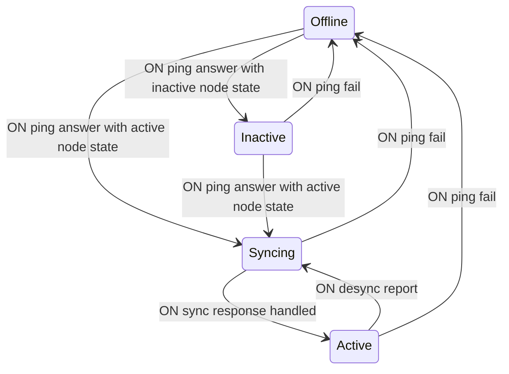

# Mesh

## Node connection status

Nodes keep pinging each other, checking their peers status.

Peers that don't respond are marked as `Offline`.

Peers that respond but indicate in their status response that they are not actively participating in the MPC network, are marked as `Inactive`.

Peers that respond and are participating in the MPC network are first listed as
`Syncing` and receive a sync request. Only after the response for that has been
answered, can the connection status transition to `Active`. Only peers with a
connection status `Active` are valid for inclusion in the participant list of
any protocol invocations. An `Active` peer goes back to `Syncing` when we learn
our record of what it stores is wrong, see [state sync](state-sync.md).
