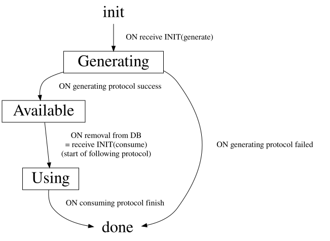
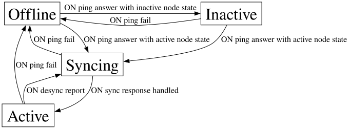
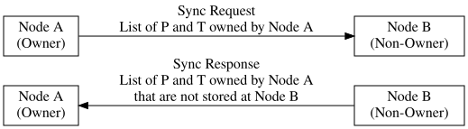

# MPC Node Specification

This document describes how an MPC node is supposed to interact with other
nodes, in a way that the network can execute signature requests in a stable and
reliable manner.

It's a high level specification, describing the distributed algorithms and
messages.

## Definitions

### Protocols

The MPC network has three protocols that it serves.

- Triple Generation
- Pre-signature Seneration
- Signature

These are distributed algorithms. The execution of such an algorithm across the
network will be called `protocol invocation` in this document.

When using the pre-signature generation protocol, this specification ensures no
triple is used more than once as an input. Likewise, the signature protocol must
only use each pre-signature once. This is a security assumption of the
cryptographic protocol.


### Participant Roles

Each protocol invocation (triple generation, pre-signature generation,
signature) has a list of `Participants`. One of the participants is the `Owner`
who initiates the protocol.

The `Owner` of a protocol will usually follow different steps than the rest.

The `Owner` has full control over protocol invocations and inputs that it
owns. All other participants follow blindly and must not make any decisions
about the non-owned protocol invocation on their own. This makes it easier to
avoid many common distributed faults, such as two nodes deciding differently on
the same invocation. It is not byzantine fault-tolerant, however, which this
specification explicitly not is trying to achieve.

## Triple and Pre-Signature State Machine

Triples and Pre-Signatures are persistently stored on each node. They go through
the following lifecycle. Nodes must keep track of them in order for state sync
to work.



### States

`init` and `done` are implicit states. Both are represented by not having any
information about the P or T in storage. All other states must be explicitly
stored and ideally persisted.

#### Generating

A P or T in the `Generating` state has an active protocol invocation that will
generate it on success. It is treated the same way as `Available` for state
sync. But the storage does not actually hold the P or T, yet.

#### Available

In the `Available` phase, a P or T share is currently ready to be used in a
protocol. This state always implies that the P or T is available in state. As
soon as it is removed from persistent storage, we must persist the state change
to `Using`.

#### Using

A P or T in the `Using` state is currently being used in a protocol invocation.
We need to track this in order for state sync to not delete any data that's
still in use.

Only transition from `Using` to `done` when either the protocol finishes
successfully, or we hit the global protocol timeout. Once that transition
happens, the node can delete all info about the P or T and its ID from
persistent storage.


## Participant Selection

When a proposer selects a list of participants for a new protocol invocation, it should check these conditions:

- Participants must be online
- Participants must hold the relevant P and T shares

To enable the first, nodes keep a connection status for every peer. For the
second part, they keep a directory of each owned P and T with a list of share
holders. Both data structures are further specified below.

### Node Connection Status



Nodes keep pinging each other, checking their peers status.

Peers that don't respond are marked as `Offline`.

Peers that respond but indicate in their status response that they are not actively participating in the MPC network, are marked as `Inactive`.

Peers that respond and are participating in the MPC network are first listed as
`Syncing` and receive a sync request. Only after the response for that has been
answered, can the connection status transition to `Active`. Only peers with a
connection status `Active` are valid for inclusion in the participant list of
any protocol invocations. An `Active` peer goes back to `Syncing` when we learn
our record of what it stores is wrong, see below.

### Share holder directory

An owner of a P and a T must always know which peers are holding a share of it.
It should keep this information up-to-date in a directory that's fully persisted.


```
# Example directory of node A

Triple 0: [Node B, Node C, Node D]
Triple 1: [Node B, Node C, Node D]
Triple 2: [Node B, Node D]
```

Note that this directory only contains entries for inputs owned by the node.

To keep this list up-to-date, nodes implement state sync.

### State Sync

Nodes may sometimes lose their persisted database. The network has to recover
from that without causing instability. That's why we have state sync, which
updates the directory used for participant selection.

State sync runs everytime a node connects to another, either after a fresh boot,
or when re-connecting after the connection was lost for another reason. It also
runs when a peer rejects a proposal for an artifact we list it as holding: that
reject is proof our record for that peer is stale, and re-syncing it repairs
every artifact it is missing, not only the one that happened to be proposed.



During state sync, the owner sends a list of Pre-signatures and Triples that it expects the other node to hold a share of. Specifically, it sends all owned IDs which satisfy:

- Is in the current directory of the owner
- The non-owning peer node (Node B) is in the list of valid participants in the owner's directory
- The owner currently holds the input data as `Available`, `Generating`, or `Using`.

The peer and afterwards the owner will then update their view on who holds which
data. This has to be done with care, to avoid race conditions. The following
describes all cases.

#### Non-owner action on state sync

Peer state of P or T | P or T is included in sync request | P or T is NOT included in sync request
-- | -- | --
Init / done / lost | <= respond missing | nop
Generating | nop | can delete
Available | nop | can delete
Using | nop | nop (let protocol finish)

Node B must always respond with a list of IDs that were in the request but node
B no longer holds the corresponding input in storage, in any state.

Node B can optionally use the sync request to delete all inputs
owned by node A that are not in the list, if B holds them as `Available` or
`Generating`.

Do not delete anything in `Using`, as it suggests the protocol has
not finished globally yet, even if on the owner's view it already has finished.


#### Owner action on state sync

Node A (owner) uses the response of node B to update its directory, as shown in
the table below.

Owner state of P or T | Owner action if peer responds with missing P or T
-- | --
Init / done / lost | nop (nothing to delete)
Generating | nop
Available | delete participant
Using | nop

Deleting from the directory should only happen if the current state as seen by the owner is `Available`.

The owner should not delete in `Generating`, as it could mean the peer simply hasn't processed the INIT(generate) message, yet.

The owner should not delete in `Using`, as it could mean the peer is already in `done` for this P or T.


#### Proof of all combinations

To prove that state-sync never messes up the directory or deletes too much data,
we have to consider all combinations of states on both ends.

The table below describes what happens in each of these cases, according to the
actions defined in this specification.


Owner / Peer | init | Generating | Available | Using | done | lost in crash
-- | -- | -- | -- | -- | -- | --
init | nop | Impossible: owner goes to Generating when it sends INIT(generate) | Impossible: owner goes to Generating when it sends INIT(generate) | Impossible: owner goes to Generating when it sends INIT(generate) | nop | nop
Generating | <= respond missingOwner ignores it | nop | nop | nop | Impossible, owner would never send INIT(output) while still generating the input | <= respond missingOwner should delete participant(but ignores it because it could also be init)
Available | Impossible: owner can’t reach Available before all participants are at least at Generating, since protocol won’t start before everybody is in Generating already | nop | nop | nop | Impossible, owner goes to Using when sending INIT | <= respond missingOwner deletes participant
Using | Impossible, Using comes after Available, see Available/init | nop | nop | nop | <= respond missingOwner ignores it | <= respond missingOwner ignores it
done | Impossible, done comes after Available, see Available/init | Impossible: peer must be in Prepare(consume) and Using(generate) when owner sends INIT(consume) | Impossible: peer must be in Prepare(consume) and Using(generate) when owner sends INIT(consume) | nop(partially finished protocol) | nop | nop
lost in crash | nop | optional: peer deletes obsolete input | optional: peer deletes obsolete input | nop | nop | nop


Note that each side only sees their own state, not that of the other side.
Therefore, we have to do the same peer actions in all columns and the same owner
action in all rows. Further, neither side can differentiate between the `init` /
`done` / `lost` states. So they must also have the same actions for all those
states.

Provably impossible states are key for correctness. The `Prepare` phase
specifically allows to mark all cases impossible where one node would still be
in `init` while others are already `Running`.
