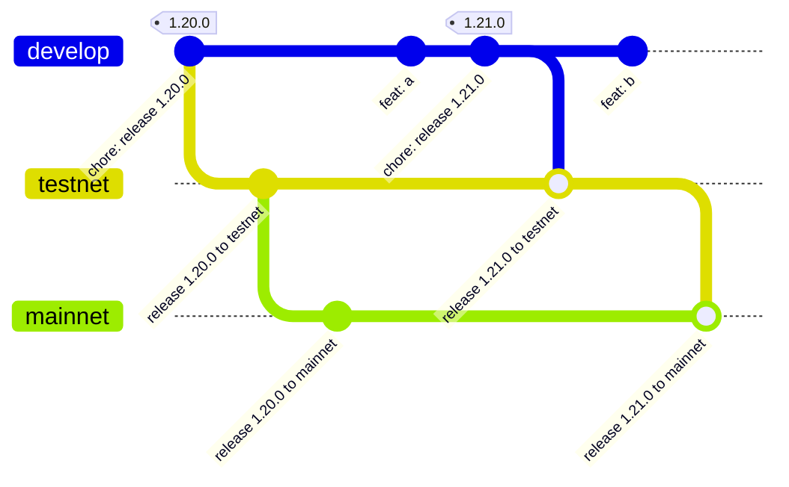
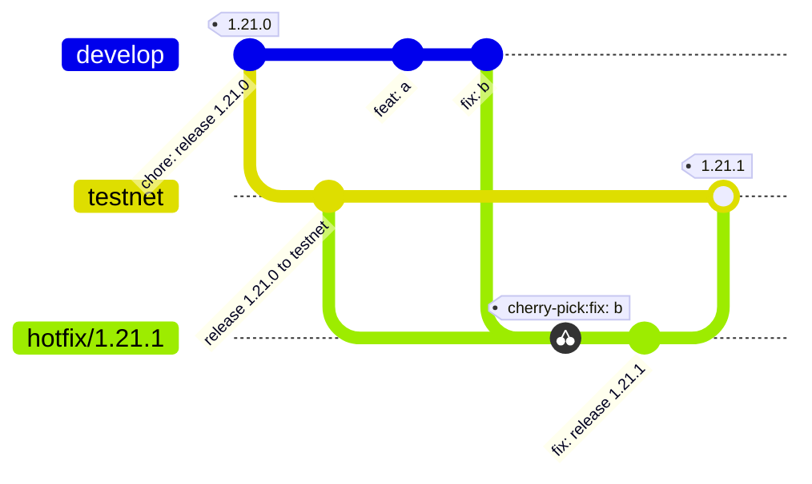

# Releasing

## Branches

[GitLab flow](https://about.gitlab.com/topics/version-control/what-is-gitlab-flow/) with environment branches and upstream-first hotfixes. A release is cut on `develop` and promoted to `testnet`, then to `mainnet`:



| Branch    | Contains                         |
|-----------|----------------------------------|
| `develop` | Integration branch; all PRs land here |
| `testnet` | The release on testnet           |
| `mainnet` | The release on mainnet           |

Code moves downstream only.

`testnet` and `mainnet` are protected: nobody can push to them directly, admins included. They change only by merging a PR, either a promotion PR or a hotfix cherry-pick PR.

`develop` only allows squash merges, through the merge queue, so each PR becomes a single commit.

`testnet` and `mainnet` only allow merge commits. A merge commit keeps the `develop` commits with their original SHAs, so git knows they are already on the branch and each promotion PR shows only what is new. Squash or rebase merges would create copies, and every promotion PR would show all past commits again and conflict with them.

## Versioning

We use [semantic versioning](https://semver.org/). The version is `version` under `[workspace.package]` in the root `Cargo.toml`. Tags are the bare version, e.g. `1.21.0`.

Every tag has a GitHub release whose notes are the PR description. Release and hotfix PRs use the [release](../.github/PULL_REQUEST_TEMPLATE/release.md) and [hotfix](../.github/PULL_REQUEST_TEMPLATE/hotfix.md) PR templates: **Summary**, **Breaking changes** (`None`, or each with its type and required action) and a **Checklist** that is not part of the notes. [1.21.0](https://github.com/sig-net/mpc/pull/1395) is an example. Right after the PR merges:

```sh
git tag X.Y.Z <commit> && git push origin X.Y.Z
gh pr view <pr> --json body --jq .body | sed '/^## Checklist/,$d' | gh release create X.Y.Z --verify-tag --notes-file -
```

- Release: the commit is the release commit on `develop`, the PR is the release PR.
- Hotfix: the commit is the merge commit of the hotfix PR on `testnet` or `mainnet`, the PR is the hotfix PR.

Promotion to testnet or mainnet does not create a tag.

## Release flow

Every second Tuesday is a **release day**. On it, in this order:

1. [Promote to mainnet](#step-1-promote-to-mainnet) the release that soaked on testnet.
2. [Cut the next release](#step-2-cut-the-release) on `develop`.
3. [Promote it to testnet](#step-3-promote-to-testnet).
4. [Soak](#step-4-soak) it there until the next release day.

### Step 1: Promote to mainnet

1. Push a `promote/X.Y.Z-mainnet` branch at the `testnet` commit that finished the soak:
   ```sh
   git fetch origin
   git switch -c promote/X.Y.Z-mainnet origin/testnet
   git push origin promote/X.Y.Z-mainnet
   ```
2. Open a PR from `promote/X.Y.Z-mainnet` to `mainnet` titled `chore: release X.Y.Z to mainnet` and merge it with a merge commit. Never promote from `develop` or open the PR from `testnet` directly, so `mainnet` gets exactly what was soaked. If the version line conflicts with a hotfix bump, take the version from the promote branch.

### Step 2: Cut the release

1. Bump the version, run `cargo check` to update `Cargo.lock`, and open a PR against `develop` titled `chore: release X.Y.Z` from the release template:
   ```sh
   gh pr create --base develop --title "chore: release X.Y.Z" --body-file .github/PULL_REQUEST_TEMPLATE/release.md
   ```
2. Write the **Summary** and **Breaking changes**. The breaking changes are those from the Breaking changes sections of the PRs merged since the last release, cross-checked against their diffs. Tick the **Checklist**.
3. Merge it. The squash commit on `develop` is the **release commit**; the PR page shows its SHA.
4. Tag the release commit and publish the GitHub release, see [Versioning](#versioning).

### Step 3: Promote to testnet

1. Push a `promote/X.Y.Z` branch at the tag. Commits merged to `develop` after the release commit wait for the next release:
   ```sh
   git fetch origin
   git switch -c promote/X.Y.Z X.Y.Z
   git push origin promote/X.Y.Z
   ```
2. Open a PR from `promote/X.Y.Z` to `testnet` titled `chore: release X.Y.Z to testnet` and merge it with a merge commit. Don't open it from `develop`: the PR would pick up anything merged to `develop` while it is open. If the version line conflicts with a hotfix bump, take the version from the promote branch.

### Step 4: Soak

The release stays on testnet until the next release day, at least 7 days. It is ready for mainnet when no open issue labeled `regression` points at it. Anyone who sees a regression on testnet, from alerts, dashboards or reports, opens such an issue. A [hotfix](#hotfixes) closes it and restarts the 7 days.

Out-of-schedule releases to `testnet` are possible but discouraged. If a feature cannot wait, cut a release and promote it to `testnet`; it replaces the soaking release, which never reaches `mainnet`. This restarts the 7 days and can postpone the mainnet promotion by up to 7 days.

## Hotfixes

Fixes land on `develop` first, then get cherry-picked downstream, so `develop` never loses a fix. The only exception is a bug that no longer exists on `develop` (see below). Each hotfix bumps the patch version of the release it fixes; `develop` never gets patch bumps. For example, a hotfix for 1.21.0 on `testnet`:



### Bug on testnet

For example, `testnet` has 1.21.0:

1. Merge the fix to `develop` as a normal PR.
2. Branch off `testnet` and cherry-pick the fix. `-x` records the original commit in the message, since the cherry-pick gets a new SHA:
   ```sh
   git fetch origin
   git switch -c hotfix/1.21.1 origin/testnet
   git cherry-pick -x <fix-commit>
   ```
3. Bump the version to `1.21.1`, run `cargo check` to update `Cargo.lock`, and commit as `fix: release 1.21.1`.
4. Push the branch and open a PR to `testnet` titled `fix: hotfix 1.21.1 to testnet` from the hotfix template:
   ```sh
   gh pr create --base testnet --title "fix: hotfix 1.21.1 to testnet" --body-file .github/PULL_REQUEST_TEMPLATE/hotfix.md
   ```
5. Write the **Summary** and **Breaking changes** and tick the **Checklist**.
6. Merge it with a merge commit.
7. Tag the merge commit and publish the GitHub release, see [Versioning](#versioning).

If `mainnet` has the same bug and it cannot wait for the next release day, hotfix it too, as below.

### Bug on mainnet

Same steps against `mainnet`, with the mainnet release's patch version, e.g. 1.20.0 to `1.20.1`.

Then hotfix `testnet` the same way, with its own patch version (e.g. `1.21.1`), unless the release there already contains the fix. Otherwise the next promotion would bring the bug back to `mainnet`. With both branches fixed, the next promotion only conflicts on the version line; take the version from the promote branch, `1.21.1`.

### When the cherry-pick doesn't apply

- If `develop` has changed the surrounding code, resolve the conflicts on the hotfix branch and point reviewers to the `develop` commit so they can compare.
- If the bug no longer exists on `develop`, write the fix directly on the hotfix branch and say why in the PR description.
