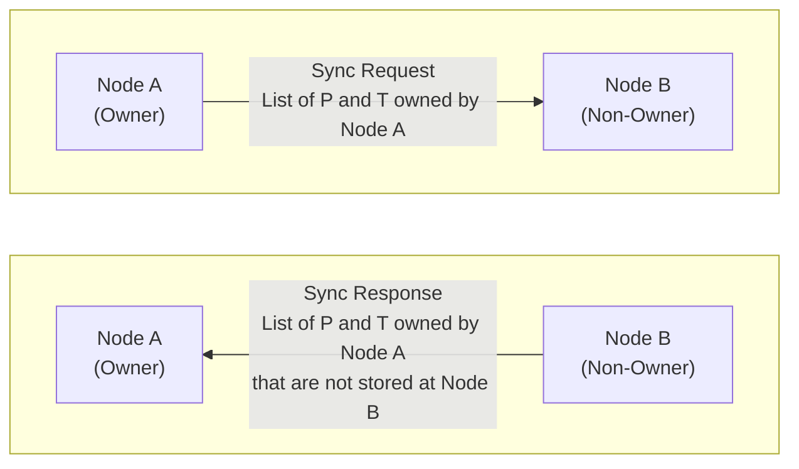

# State Sync

Nodes may sometimes lose their persisted database. The network has to recover
from that without causing instability. That's why we have state sync, which
updates the directory used for participant selection.

State sync runs everytime a node connects to another, either after a fresh boot,
or when re-connecting after the connection was lost for another reason. It also
runs when a peer rejects a proposal for an artifact we list it as holding: that
reject is proof our record for that peer is stale, and re-syncing it repairs
every artifact it is missing, not only the one that happened to be proposed.

During state sync, the owner sends a list of Pre-signatures and Triples that it expects the other node to hold a share of. Specifically, it sends all owned IDs which satisfy:

- Is in the current directory of the owner
- The non-owning peer node (Node B) is in the list of valid participants in the owner's directory
- The owner currently holds the input data as `Available`, `Generating`, or `Using`.

The peer and afterwards the owner will then update their view on who holds which
data. This has to be done with care, to avoid race conditions. The following
describes all cases.

## Non-owner action on state sync

Peer state of P or T | P or T is included in sync request | P or T is NOT included in sync request
-- | -- | --
Init / done / lost | <= respond missing | nop
Generating | nop | can delete
Available | nop | can delete
Using | nop | nop (let protocol finish)

Node B must always respond with a list of IDs that were in the request but node
B no longer holds the corresponding input in storage, in any state.

Node B can optionally use the sync request to delete all inputs
owned by node A that are not in the list, if B holds them as `Available` or
`Generating`.

Do not delete anything in `Using`, as it suggests the protocol has
not finished globally yet, even if on the owner's view it already has finished.

## Owner action on state sync

Node A (owner) uses the response of node B to update its directory, as shown in
the table below.

Owner state of P or T | Owner action if peer responds with missing P or T
-- | --
Init / done / lost | nop (nothing to delete)
Generating | nop
Available | delete participant
Using | nop

Deleting from the directory should only happen if the current state as seen by the owner is `Available`.

The owner should not delete in `Generating`, as it could mean the peer simply hasn't processed the START yet.

The owner should not delete in `Using`, as it could mean the peer is already in `done` for this P or T.

## Proof of all combinations

To prove that state-sync never messes up the directory or deletes too much data,
we have to consider all combinations of states on both ends.

The table below describes what happens in each of these cases, according to the
actions defined in this specification.

Owner / Peer | init | Generating | Available | Using | done | lost in crash
-- | -- | -- | -- | -- | -- | --
init | nop | Impossible: owner goes to Generating when it sends PROPOSE | Impossible: owner goes to Generating when it sends PROPOSE | Impossible: owner goes to Generating when it sends PROPOSE | nop | nop
Generating | <= respond missingOwner ignores it | nop | nop | nop | Impossible, owner would never send PROPOSE for the output while still generating the input | <= respond missingOwner should delete participant(but ignores it because it could also be init)
Available | Impossible: owner can’t reach Available before all participants are at least at Generating, since protocol won’t start before everybody is in Generating already | nop | nop | nop | Impossible, owner goes to Using before sending START | <= respond missingOwner deletes participant
Using | Impossible, Using comes after Available, see Available/init | nop | nop | nop | <= respond missingOwner ignores it | <= respond missingOwner ignores it
done | Impossible, done comes after Available, see Available/init | nop: happens when the peer had not stored the input yet, so it could not accept and START went to others; once stored, see done/Available | optional: peer deletes obsolete input (happens when the peer's ACCEPT was late, as START goes only to the accepters) | nop(partially finished protocol) | nop | nop
lost in crash | nop | optional: peer deletes obsolete input | optional: peer deletes obsolete input | nop | nop | nop

Note that each side only sees their own state, not that of the other side.
Therefore, we have to do the same peer actions in all columns and the same owner
action in all rows. Further, neither side can differentiate between the `init` /
`done` / `lost` states. So they must also have the same actions for all those
states.

Provably impossible states are key for correctness. The posit phase
specifically allows to mark all cases impossible where one node would still be
in `init` while others are already `Generating`: START only goes to nodes that
accepted, and nobody generates before START.
